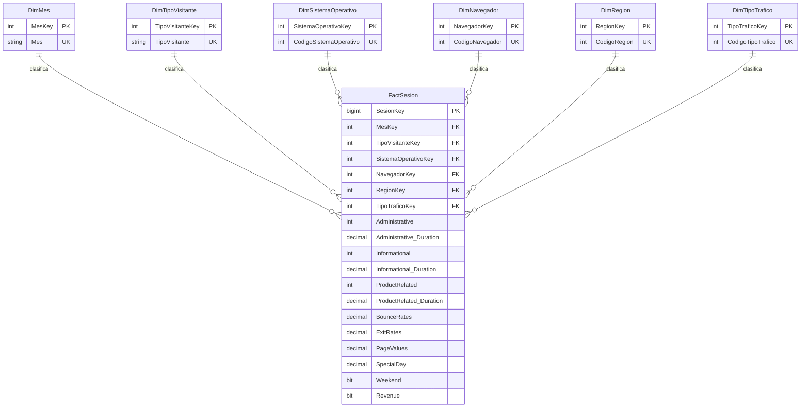

# Diagrama del Data Mart

## Grano

Una fila de `FactSesion` representa una sesión del dataset procesado. La llave sustituta `SesionKey` se genera en la base y no existe en el CSV original.

## Esquema estrella

`StgSesiones` recibe las 18 columnas del CSV antes de poblar el esquema estrella. `FactSesion` conserva las medidas de navegación y los indicadores de fin de semana y compra.

## Implementación

- Creación de base y tablas: `sql/01_crear_base_y_datamart.sql`.
- Carga CSV, dimensiones y hechos: `sql/02_cargar_dataset.sql`.
- Dataset fuente de la carga: `data/processed/online_shoppers_intention_clean.csv`.
